<a href="https://github.com/distillium">
  <picture>
    <source media="(prefers-color-scheme: dark)" srcset="./assets/banner-dark.svg">
    
  </picture>
</a>

<p align="center">
  
  
  
  
  
  
</p>

### ✦ Projects

<table>
<tr>
<td width="50%" valign="top">
<a href="https://github.com/distillium/warp-native">
<picture><source media="(prefers-color-scheme: dark)" srcset="./assets/card-warp-native-dark.svg"></picture>
</a>
<p align="center"> </p>
</td>
<td width="50%" valign="top">
<a href="https://github.com/distillium/remnawave-backup-restore">
<picture><source media="(prefers-color-scheme: dark)" srcset="./assets/card-remnawave-backup-restore-dark.svg"></picture>
</a>
<p align="center"> </p>
</td>
</tr>
<tr>
<td width="50%" valign="top">
<a href="https://github.com/distillium/motd">
<picture><source media="(prefers-color-scheme: dark)" srcset="./assets/card-motd-dark.svg"></picture>
</a>
<p align="center"> </p>
</td>
<td width="50%" valign="top">
<a href="https://github.com/distillium/socks5-proxy-manager">
<picture><source media="(prefers-color-scheme: dark)" srcset="./assets/card-socks5-proxy-manager-dark.svg"></picture>
</a>
<p align="center"> </p>
</td>
</tr>
</table>

### ✦ Quick start

```bash
# Cloudflare WARP as a native WireGuard interface
bash <(curl -fsSL https://raw.githubusercontent.com/distillium/warp-native/main/install.sh)
```

<p align="center">
  
</p>
